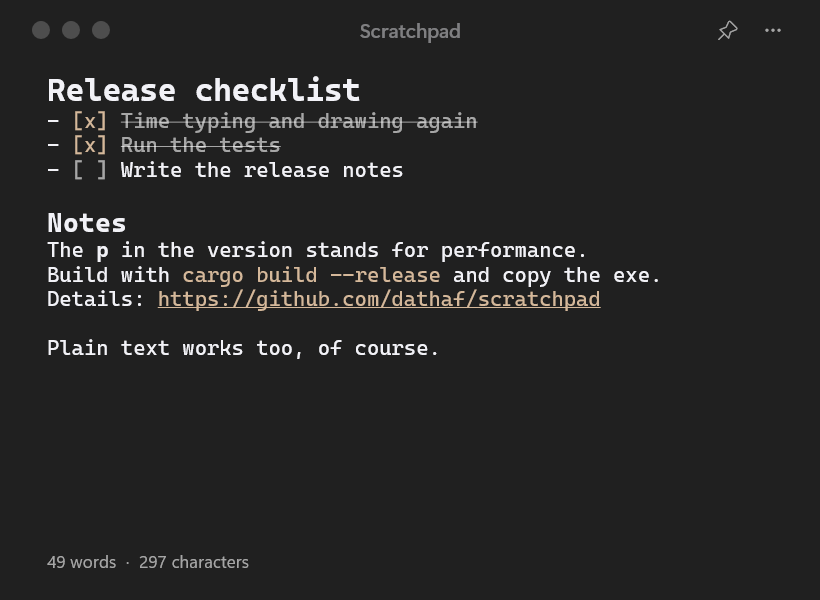

# Scratchpad

A small, always-there note window for Windows 11. One note, one hotkey, no waiting.



Scratchpad is written in Rust directly against the Windows API: no .NET, no browser engine, no
runtime to install. It is a single `.exe` of about 500 KB that starts in about 0.1 s and uses
about 9 MB of memory.

## Features

- **One note that saves itself.** Half a second after you stop typing, the note is on disk.
- **A global hotkey** (default `Alt` + `X`) brings the window up from anywhere; `Esc` puts it away.
  The app keeps running in the notification area.
- **Light Markdown**: headings, **bold**, `code`, checklists you can tick, links you can open.
  The syntax characters hide while the caret is somewhere else, so the note reads like a document.
- **Search and replace**, undo and redo, any installed font, adjustable size and line spacing.
- **Translucent backdrop**: Acrylic, Mica or Liquid, with adjustable opacity; light, dark or
  following Windows.
- **Title bar your way**: round buttons on the left or symbols on the right, shown always, on
  hover or never.
- **Daily backups**: the first save of a day keeps yesterday's note; the last 10 days stay.
- **German or English** interface.

## Install

Download `Scratchpad.exe` from the [releases](../../releases) and run it. There is no installer;
put the file wherever you like. "Start with Windows" in the menu adds it to autostart.

Requires Windows 11 22H2 or newer for the translucent backdrops.

## Keyboard

| Keys | Action |
|---|---|
| `Alt` + `X` | Show or hide the window (can be changed in the menu) |
| `Esc` | Hide the window |
| `Ctrl` + `F` / `Ctrl` + `H` | Find / replace |
| `Enter`, `F3`, `↓` / `Shift` + `Enter`, `↑` | Next / previous match |
| `Ctrl` + `B` | Make the selection bold |
| `Ctrl` + `Enter` | Tick or untick the checklist item in the caret's line |
| `Ctrl` + click | Open the link under the pointer |
| `Ctrl` + `+` / `-` / `0`, `Ctrl` + wheel | Larger / smaller / default text size |
| `Ctrl` + `Z` / `Ctrl` + `Y` | Undo / redo |
| `Ctrl` + `S` | Save now (it saves itself anyway) |
| `Ctrl` + `Q` | Quit |

## Markdown

| You type | You get |
|---|---|
| `# Title` … `###### Title` | A heading, level 1 to 6 |
| `**text**` | Bold text |
| `` `text` `` | Code, in the accent colour |
| `- [ ] task` | A checklist item; `- [x] task` is done and struck through |
| `- item` or `* item` | A list item; `Enter` continues the list |
| `https://…` or `www.…` | A link |

There are deliberately no single-asterisk italics: in everyday notes a lone `*` usually means
something else (`64*64`). Markdown styling can be switched off in the menu.

## Where the data lives

`%APPDATA%\Scratchpad\scratch.txt` is the note, `settings.json` next to it holds the settings.
The note is a plain text file; any editor can open it.

- **Another folder:** "Note folder" in the menu moves the note, for example into a synced folder.
  If another computer changes the file, it is reloaded when the window is activated; if that
  collides with local changes, the other version is kept as `scratch (backup …).txt`.
- **Backups:** `Backups\scratch YYYY-MM-DD.txt` next to the note, one per day on which the note
  changed, holding the state from before that day's first change.

## Performance

The **p** in the version number stands for **performance**. It is a promise rather than a
decoration: no version ships before typing, caret movement and drawing have been timed again,
and a feature that would slow the app down noticeably does not get in.

| | 1 KB note | 100 KB note |
|---|---|---|
| Handling a keystroke | about 0.03 ms | under 0.1 ms |
| Moving the caret | about 0.005 ms | about 0.005 ms |
| Redrawing the window | under 1 ms | under 1 ms |

Measured on the author's PC in version 1.9p. A large note stays fast because the editor works
paragraph by paragraph: typing only lays out the paragraph you are in, and only the visible
paragraphs are drawn.

## Building

Needs Rust with the GNU toolchain (`stable-x86_64-pc-windows-gnu`); no Visual Studio Build Tools.

```
cargo test --release
cargo build --release
```

The exe is `target\release\Scratchpad.exe`. Quit a running Scratchpad first (`Ctrl` + `Q`) if you
want to overwrite the one it was started from.

For tests on the window, set the environment variable `SCRATCHPAD_TEST` and point `APPDATA` at an
empty folder: a test copy then runs beside the real app without touching the real note.

## Source layout

| File | Contents |
|---|---|
| `src/main.rs` | Window, title bar, search, tray icon, hotkeys, running in the background |
| `src/menu.rs` | The "⋯" menu (the app's own, self-drawn popup window) |
| `src/editor.rs` | Text field: caret, selection, undo, wrapping, scrolling, Markdown (on DirectWrite) |
| `src/gfx.rs` | Drawing surface: Direct2D into a memory buffer with transparency |
| `src/settings.rs` | Settings, the note file and its backups |
| `src/lang.rs` | The two interface languages |
| `src/sys.rs` | Registry (colour scheme, accent colour, autostart), icon, dark menus |
| `build.rs` | Embeds `app.ico` and `app.manifest` into the `.exe` (without a resource compiler) |

## Versions

Every shipped version has a Git tag (`v1.7p`, `v1.8p`, …). `git log --oneline` lists them,
`git checkout v1.7p` brings back an old state.

## License

MIT, see [LICENSE](LICENSE).
